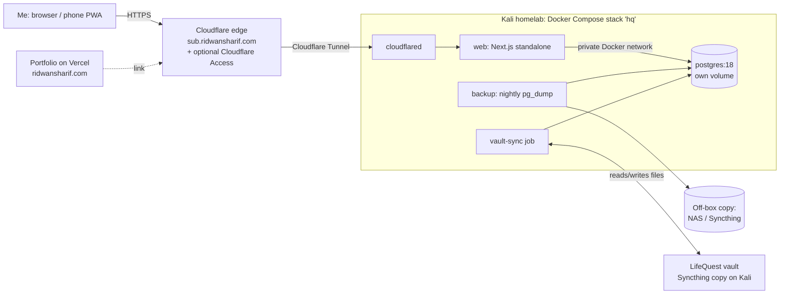
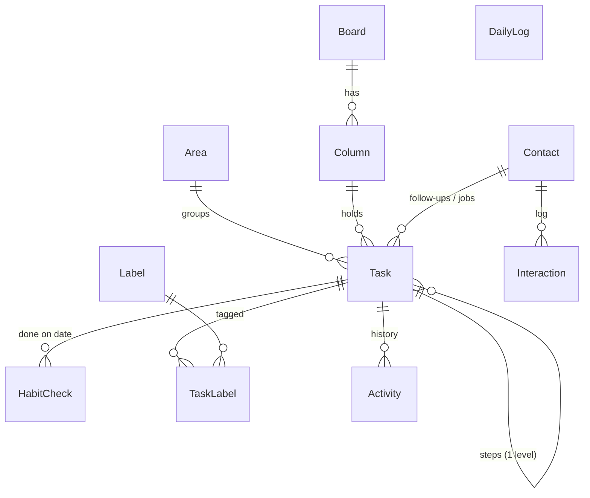

# HQ — Plan

**hq.ridwansharif.com** — an early version of LifeQuest.

> **A simple task tracker so my ADHD brain doesn't forget what I assigned myself.**
> Capture in seconds, see what's due, get reminded. Self-hosted on the homelab, on a
> subdomain of ridwansharif.com (name TBD).

## Scope change (2026-11-21): simple tracker first

The original plan (below) grew into a full LifeQuest app. That's parked. v1 is a plain,
fast task tracker. The database is already LifeQuest-shaped, so it can grow into that later
without a rewrite.

| In v1 | Parked (code/data kept, hidden or not built) |
|---|---|
| Quick capture box on every page ("pay rent every month 12/1 !") | XP / levels / streak stats |
| Today: Overdue → Today → Inbox → Next 7 days, Done today | Job-hunt board (hidden from menu) |
| Repeating tasks: daily / weekdays / weekly / monthly, roll forward on completion | CRM pages, daily-log pages |
| All tasks page (nothing out of sight) | Vault write-back, AI quests, multi-user |
| Habits with 7-day dots | Arcnir-style column management (still on Quests board) |
| Quests board + LifeQuest vault import (kept, it's already built) | |
| **Telegram reminders** (next) | |

Decided 2026-10-06:

| Decision | Choice |
|---|---|
| Database | **Own Postgres container in this app's homelab stack**, separate from ARCNIR's DB platform (changed 2026-11-21). No cloud fallback |
| Hosting | **Fully self-hosted on the homelab (Kali)**: Docker Compose (Next.js + Postgres + backup job), public via Cloudflare Tunnel. No Vercel (changed 2026-11-21) |
| Repo | **Its own git repo**, separate from ARCNIR and the portfolio. User pushes |
| LifeQuest data sharing | **DB is the source of truth, vault is a mirror.** Import the vault once (re-runnable, IDs stamped in frontmatter), then export back to Markdown so Obsidian + the Telegram bot still work |
| Subdomain | Not decided yet. Candidates: `hq.` / `quest.` / `os.` |
| v1 scope | Quest kanban, CRM, daily logs + streaks/XP, recurring habits; job hunt is lower priority |

---

## 1. Where it lives

- **A separate Next.js app, not code inside the portfolio repo.** The portfolio is Tailwind 3
  with a Redis content store. The pieces we're taking from Arcnir are Tailwind 4 + Prisma +
  Postgres, so copying them into a fresh app is far easier than retrofitting the portfolio.
  It's still "part of" the portfolio: same domain, same fonts (Lora + JetBrains Mono), same
  accent-theme idea, and a link from the portfolio nav.
- **Self-hosted, its own everything:** own git repo, own Compose stack, own Postgres. Nothing
  shared with ARCNIR's hosting or DB, so an ARCNIR outage or migration can't touch it.
- Subdomain hookup: add a public hostname to a Cloudflare Tunnel (`.ridwansharif.com` →
  `http://web:3000`). This needs ridwansharif.com's DNS on Cloudflare (it's on Namecheap → Vercel
  today); moving the nameservers is free, and the portfolio's Vercel records get re-created there.
- Postgres is never exposed: only the `web` container can reach it, on the internal Docker network.
- Single owner: login uses the same PBKDF2 + HMAC-cookie pattern as the portfolio admin
  (`lib/adminAuth.ts`). No users table and no RBAC.

## 2. What we're taking from Arcnir (and what we're not)

| Arcnir piece | Take? | Becomes |
|---|---|---|
| `work/task-board.tsx`: columns, drag + "Move to", optimistic moves | ✅ | Quest board, Job board, any custom board |
| `WorkflowNode.category`: a column's *meaning* sets the task's status | ✅ | Same. You can name columns anything and done/overdue/XP still work |
| Subtasks (one level) | ✅ | **Quest → Steps** |
| Labels (theme-token colours), priority, `dueOn` as a date (not an instant) | ✅ | Same |
| `TaskActivity` append-only history | ✅ | Activity log + **XP ledger + streak source** |
| List / Timeline views, filters, My Work | ✅ (phase 2) | Today page + list/timeline |
| Leads → Clients pipeline, client profile, communication log | ✅ adapted | **Personal CRM**: contacts, interactions, follow-up dates |
| Calendar view | ✅ (phase 3) | Due dates + follow-ups + habits on one calendar |
| PWA (`sw.js`, install-app) | ✅ (phase 3) | Installable on the phone |
| Notifications inbox | 🟡 later | Follow-up and habit reminders (in-app first, Telegram later) |
| Flow canvas (@xyflow) | 🟡 maybe | Visual campaign map |
| RBAC, delegation, watchers, multi-assignee, invoices, signatures, questionnaires, appointments, blog/CMS | ❌ | Single-user app, not needed |

## 3. What comes from LifeQuest

- Life → **Campaign** (`Area`, kind `campaign`) → **Quest** (`Task` kind `quest`) → **Step** (`Task` kind `step`, `parentId` = quest)
- Dev Projects → `Area` kind `dev-project`; phases → quests
- `weekly_focus`, `priority`, `status`, and the `> 💬 Ask Claude:` prompt on each step (`claudePrompt` field, with a copy button)
- Daily Log template → `DailyLog` (one word, one thing, mood morning/evening, energy, gratitude, wins, blockers)
- Design Brainstorm features: recurring steps (1.1), streaks (2.1), burst-completion praise (1.4); AI quest generation (1.2/1.3) comes later

## 4. Data model (Prisma, Postgres)

The full schema is in `web/prisma/schema.prisma`. Key ideas:
- **One `Task` table for everything** (quest, step, task, habit, job) with a `kind` column.
  Every board, filter and XP rule works on all of them.
- **`vaultId` + `vaultHash`** on Task/Area/DailyLog make the vault sync idempotent: re-running
  the import updates rows instead of duplicating them.
- **XP and streaks are derived from `Activity` rows** (append-only), so they can be recalculated
  and are never stored only as a counter that drifts.
- Habits: `recurrence` (`daily`, `weekly:mon,wed,fri`) plus one `HabitCheck` row per day.
  Nothing "resets" at midnight; "done today" just means a check row exists for today.

## 5. Vault ⇄ DB sync

1. **Import** (`npm run vault:import`): walk `Campaigns/*` and `Dev Projects/*`, parse
   frontmatter and `- [ ]` steps, upsert into the DB, and write `lq_id: <id>` back into each
   quest's frontmatter (dry-run by default, `--write` to stamp; a backup is made first).
2. **Export** (phase 2, `npm run vault:export`): the DB regenerates the checkbox states and
   frontmatter status in the vault files for quests whose `vaultHash` changed. It never deletes files.
3. The Telegram bot / headless Claude keeps writing new quest files, and the next import picks them up.

## 6. Phases (simple-tracker scope)

| Step | Deliverable | Status |
|---|---|---|
| 1 | Foundation: login, shell, schema, Quests board, Today, habits, vault import | ✅ 2026-10-06 |
| 2 | Docker stack + own git repo | ✅ 2026-11-21 (not yet run on Kali) |
| 3 | Quick capture, Inbox, repeating tasks, trimmed Today, All tasks, task edit | ✅ 2026-11-21 |
| 4 | Timed tasks + push notifications (installable app, Done/Snooze, morning digest, Telegram fallback) | ✅ 2026-11-21 (verified with a real Edge push; not yet on a phone) |
| 5 | Deploy on Kali + tunnel + hq.ridwansharif.com (DNS → Cloudflare) | ⬜ next, needs user |
| 6 | Take over the SecondBrain bot's jobs (see below) | ⬜ |
| 7 | Calendar sync: HQ ⇄ calendar, both directions (see below) | ⬜ |
| 8 | Android app wrapper + home-screen widget (Today list, quick add) | ⬜ |
| later | Parked LifeQuest features (see table above) if still wanted after a month of daily use | ⬜ |

## 6b. Taking over the SecondBrain Telegram bot (decided 2026-11-21)

Bot lives at `L:\SecondBrain\secondbrain-bot` (Python, on Kali). Decision: **HQ takes over every
job; the bot stays as a thin backup** (messages → HQ tasks/captures, fallback alert channel).
Move one job at a time, both running side by side, switch off in the bot only once proven.

| Bot job today | In HQ |
|---|---|
| Text → headless Claude Code in the LifeQuest vault (sessions, `/reset`) | "Ask Claude" page; same `claude -p` call + token, in an HQ container with the vault mounted. Owner login + Cloudflare Access before exposing it |
| `note:` / voice / photo / document → `SecondBrain/Inbox` | Attachments on the capture box writing the SAME Inbox files (Whisper + agents unchanged) |
| `/notify` reminders (once/daily/weekly/random, Ollama parse) | Timed tasks ✅ (instant regex parse, no Ollama). Still to port: random nudges + migrate the bot's SQLite reminders |
| `/reminders`, `/cancel` | All tasks page / task delete ✅ |
| Approval buttons for host scripts (`/approvals` req/ans files) | Approvals list in HQ + notification with Yes/No |
| `/status` | Today summary |

## 6c. Calendar sync (asked 2026-11-21)

Two directions: tasks with a date/time **create events** in the calendar, and calendar events
**show up in HQ** (Today + All tasks). Bot's PLAN-notify-reminders.md Phase 4 already sketched
Google Calendar via OAuth refresh token (no recurring cost). **Accounts: BOTH Google accounts
(personal + ARCNIR)** — pull events from both; HQ writes new events into one chosen account
(default to be confirmed when building).

## 7. Homelab deployment (on Kali, guide first; nothing runs until you say go)

Planned stack, in its own folder on the server (`~/hq/` — NOT `~/LifeQuest`, which is the vault — cloned from the new repo):

| Service | Image | Notes |
|---|---|---|
| `web` | built from `web/Dockerfile` (Next.js `output: "standalone"`) | Runs `prisma migrate deploy` on start |
| `db` | `postgres:18` | Named volume, no published port, password from `.env` |
| `backup` | `postgres:18` + cron | Nightly `pg_dump` → `./backups`, keep 14, copy off-box (NAS/Syncthing) + ntfy on failure |
| `cloudflared` | `cloudflare/cloudflared` | Tunnel token in `.env`; public hostname → `http://web:3000` |
| `vault-sync` | same image as `web` | Runs `vault:import` on a schedule against the Syncthing copy of the vault (mounted read-write) |

Order: create the repo → push → clone on Kali → `.env` → `docker compose up -d` → seed → vault import
dry run → `--apply` → add the tunnel hostname → test a restore from a backup.

## 9. Redesign (decided 2026-11-28)

User wants HQ to be ADHD-friendly: motivating, pushy, fluid. Mockups: https://claude.ai/artifact/DR538zE4PrVv6XYrkkHrPc

**Three home views, switchable in Settings** (same data, different screens):
- **Hybrid (default)** = "One thing now" (one big task + START, focus timer, XP reward, "split it") + boss battles for overdue tasks.
- **Quest** = full game board (quest cards, XP, levels, badges, bosses).
- **Cockpit** = day timeline with "now" line + live feed.

**Shared by all views:** Spaces (Personal / Work·ARCNIR / custom, switchable, optional hide Work after hours); Feed page; nag-until-answered reminders; HQ's own focus check-ins; Telegram ✅ receipt on every done (+ backup when a phone alert goes unanswered); full-screen alarm + focus lock (Android app).

| Phase | What | Where |
|---|---|---|
| R1 ✅  Data: Space model + Task.spaceId (IT Firm/ARCNIR → Work, rest → Personal), Settings (view mode, work hours), Task.estimateMin, FocusSession, boss = overdue task (HP = open steps, auto 3 if none), XP/levels switched on | web + DB migration |
| R2 ✅  New look + shell: tokens, phone tab bar (Now / Plan / Feed / Me), desktop sidebar, space switcher, Settings → View | web |
| R3 ✅  The three home views + focus timer + reward screen (sound/animation) + split-it steps | web |
| R4 ✅  Pushiness on web: nag repeats until Done/Snooze/Start (limited snoozes), focus check-ins, Telegram ✅ receipts | web + ticker |
| R5 ✅  Feed: FeedItem table; HQ logs reminders/check-ins/digests/receipts; bot forwards Telegram chat to HQ (`/api/feed/ingest`) since only one process can read the bot's updates | web + bot (small change) |
| R6 | Android app (Capacitor, sideloaded APK): full-screen alarm (full-screen intent), focus lock (app blocker), home-screen widget | Android |

## 10. Beta for friends & family (decided 2026-11-28, NOT started)

Ridwan uses HQ alone first to get a feel for it. Later: **lifequest.arcnir.com**, a closed beta for friends & family (Rakib first).

- **Accounts:** real multi-user (not one copy per person, which won't scale past a few people). Every table gets an owner (`userId`), every query filters by it. Invite links: the invitee opens a one-time link and picks their own password (Ridwan never sees it).
- **Telegram:** no shared bot. Each user connects their own bot from Settings, using a step-by-step BotFather guide (create bot → paste token → send /start → HQ finds the chat id → test message). Ridwan's SecondBrain bot stays his only.
- **Prep that helps now:** build R4's Telegram receipts with the bot token + chat id stored in Settings (DB), not only `.env`, so the same screen works for beta users later.
- **To check before launch:** whether arcnir.com DNS is on Cloudflare (needed for the tunnel hostname); privacy notice for beta users; per-user backups/export.
