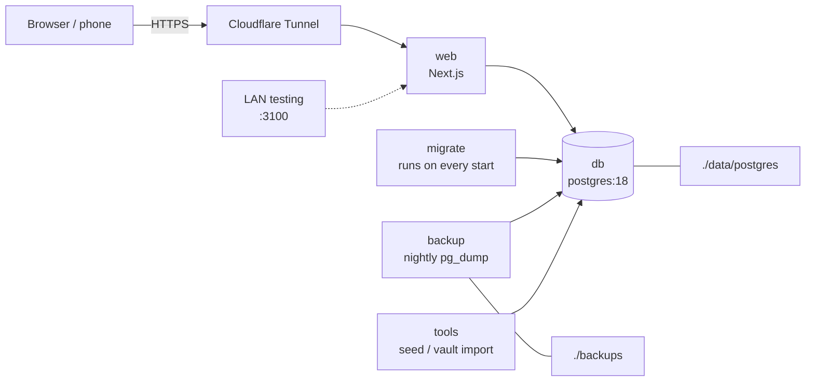

# HQ

**hq.ridwansharif.com** — an early version of LifeQuest.

Self-hosted personal task tracker built for an ADHD brain: quick capture, a Today list, repeating
tasks and habits, plus the LifeQuest quests board. Single owner. Runs entirely on the homelab:
the app and its own Postgres database, with nothing shared with ARCNIR.

- Plan, data model, phases: [`PLAN.md`](PLAN.md)
- App code: [`web/`](web/) (Next.js 16, Prisma, Postgres 18, Tailwind 4)

## Stack



| Service | What it does |
|---|---|
| `db` | Postgres 18. Data in `./data/postgres`. No published port; only other containers can reach it. |
| `migrate` | Applies database migrations, then exits. `web` waits for it. |
| `web` | The app on port 3000 inside Docker, published as `3100` on the host. |
| `ticker` | Pokes HQ every minute so due reminders and the morning digest get sent. |
| `backup` | One `pg_dump` at startup, then nightly at `BACKUP_HOUR`, into `./backups`, kept `BACKUP_KEEP_DAYS` days. |
| `tools` | One-off jobs (`docker compose run --rm tools …`). Not started by `up`. |
| `cloudflared` | Public HTTPS via Cloudflare Tunnel. Only with `--profile tunnel`. |

## First deploy (Kali server)

1. **Clone** the repo (GitHub: `LifeQuest`) into `~/hq`, **not** `~/LifeQuest` — that folder is the
   Obsidian vault the Telegram bot mounts:
   ```bash
   git clone https://github.com/Ridwan155-Akasake/LifeQuest.git ~/hq && cd ~/hq
   ```

2. **Create `.env`** with the setup script (run it yourself, it asks for your HQ password):
   ```bash
   bash deploy/setup-env.sh
   ```
   It generates the database password, ticker secret and push keys, stores only a salted hash of
   your password, optionally copies the Telegram fallback from the SecondBrain bot, and refuses to
   overwrite an existing `.env`. Nothing secret is printed. **Never regenerate the push keys**
   once phones are subscribed.
   - To reach HQ through the existing `ridwansharif.com` tunnel, add this line to `.env`:
     `COMPOSE_FILE=docker-compose.yml:deploy/compose.homelab-tunnel.yml`
   - To test from another device on your LAN first, set `WEB_BIND=0.0.0.0` and `COOKIE_SECURE=false`
     (put them back to `127.0.0.1` / `true` once the tunnel works).

3. **Create the folders** as your normal user, so the containers can write to them:
   ```bash
   mkdir -p data backups vault-backups
   ```

4. **Start it:**
   ```bash
   docker compose up -d --build
   docker compose ps
   ```
   `migrate` should show `Exited (0)`, and `web` and `db` should be `healthy`.

5. **Seed the boards:**
   ```bash
   docker compose run --rm tools npm run db:seed
   ```

6. **Import LifeQuest:** do the dry run first and read the output.
   ```bash
   docker compose run --rm tools npm run vault:import
   docker compose run --rm tools npm run vault:import -- --apply
   ```
   `--apply` writes `lq_id:` into each quest file and backs up the originals to `./vault-backups/` first.

7. **Open it:** `http://<server-ip>:3100` (LAN) or `http://localhost:3100` on the server.

## Notifications (needs the public HTTPS URL)

Push notifications only work over HTTPS, so do this after the tunnel is live:
1. On your Android phone open `https://hq.ridwansharif.com` in Chrome, sign in.
2. Chrome menu ⋮ → **Install app**. Open HQ from the new icon.
3. **Settings → Turn on notifications**, then **Send test notification**.

Tasks with a time ("call dentist at 3pm", "check oven in 20 min") ping at that time with
**Done** and **Snooze 1h** buttons. The morning summary arrives at `DIGEST_TIME`.
Check delivery with `docker compose logs ticker`.

## Backups and restore

Dumps land in `./backups/hq-YYYY-MM-DD_HHMM.dump`. **Sync that folder off the laptop**
(NAS or Syncthing). A backup that lives only on the same disk dies with that disk.

Check the backup log with `docker compose logs backup`. To test a restore (do this once after the first deploy):

```bash
docker compose exec -T db pg_restore -U hq -d hq --clean --if-exists < backups/<file>.dump
```

## Public access (Cloudflare Tunnel)

`ridwansharif.com` is already on Cloudflare and the homelab already runs its tunnel
(`cloudflared-ridwansharif`, network `homelab_dns-net`). Reuse it:

1. In `.env`: `COMPOSE_FILE=docker-compose.yml:deploy/compose.homelab-tunnel.yml`, then `docker compose up -d`.
   This joins only the `web` container to `homelab_dns-net` as `hq-web`.
2. Cloudflare Zero Trust → Networks → Tunnels → the ridwansharif tunnel → **Public hostname** →
   add `hq.ridwansharif.com` → service **HTTP** → `hq-web:3000`.
3. (Alternative, a separate tunnel: put its token in `CF_TUNNEL_TOKEN`, use `--profile tunnel`,
   service `http://web:3000`.)
4. Set `APP_URL=https://hq.ridwansharif.com`, `WEB_BIND=127.0.0.1` and `COOKIE_SECURE=true`,
   then run `docker compose up -d`.
5. Optional: put Cloudflare Access in front of the hostname as a second lock.

## Updating

```bash
git pull
docker compose up -d --build   # migrate runs automatically before web starts
```

## Local development (Windows)

From `web/`: copy `.env.example` → `.env`, point `DATABASE_URL` at a Postgres, then run
`npm install`, `npm run db:deploy`, `npm run db:seed`, `npm run dev`.
