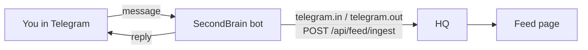

# SecondBrain bot → HQ Feed (R5)

Makes your Telegram chat with the SecondBrain bot show up in HQ's **Feed** (both directions),
and adds `/hq <text>` to drop a task straight into HQ from Telegram.

**Status:** prepared, NOT applied. The bot is live on Kali (`~/SecondBrain/secondbrain-bot`,
container `secondbrain-bot`); apply only with Ridwan's go. Not tested against the running bot.



## 1. HQ side (already in HQ from R5)

- `POST /api/feed/ingest`, header `x-feed-secret: $FEED_SECRET`, body
  `{ "kind": "telegram.in" | "telegram.out" | "alert", "text": "...", "at": "ISO", "capture": true? }`
- Off unless `FEED_SECRET` is set in `~/hq/.env` (new installs get one from `deploy/setup-env.sh`).

## 2. Bot side

### a) New file `hq_feed.py` (next to `bot.py`)

```python
"""Tell HQ what was said, so its Feed has the whole conversation. Never blocks the bot."""
import asyncio
import logging
import os
from datetime import datetime, timezone

import httpx
from telegram import Update
from telegram.ext import ContextTypes, ExtBot

log = logging.getLogger("hq_feed")
URL = os.getenv("HQ_FEED_URL", "")        # https://hq.ridwansharif.com/api/feed/ingest
SECRET = os.getenv("HQ_FEED_SECRET", "")  # same value as FEED_SECRET in ~/hq/.env
ALLOWED = int(os.getenv("TELEGRAM_ALLOWED_USER_ID", "0"))


async def post(kind: str, text: str, capture: bool = False):
    if not URL or not SECRET or not text:
        return None
    try:
        async with httpx.AsyncClient(timeout=8) as c:
            r = await c.post(
                URL,
                json={"kind": kind, "text": text[:4000], "capture": capture,
                      "at": datetime.now(timezone.utc).isoformat()},
                headers={"x-feed-secret": SECRET},
            )
            return r.json() if r.status_code == 200 else None
    except Exception as e:  # HQ down must never break the bot
        log.warning("HQ feed post failed: %s", e)
        return None


def fire(kind: str, text: str):
    asyncio.create_task(post(kind, text))


async def log_incoming(update: Update, ctx: ContextTypes.DEFAULT_TYPE):
    """Runs before every other handler (group -1). Only the owner's messages."""
    msg = update.effective_message
    user = update.effective_user
    if not msg or not user or user.id != ALLOWED:
        return
    if msg.text:
        text = msg.text
    elif msg.voice or msg.audio:
        text = "🎤 voice note"
    elif msg.photo:
        text = "📷 photo" + (f": {msg.caption}" if msg.caption else "")
    elif msg.document:
        text = f"📄 {msg.document.file_name or 'file'}"
    else:
        return
    fire("telegram.in", text)


class FeedBot(ExtBot):
    """Same bot, but every message it sends or edits is copied to HQ's Feed."""

    async def send_message(self, *args, **kwargs):
        m = await super().send_message(*args, **kwargs)
        fire("telegram.out", kwargs.get("text") or (args[1] if len(args) > 1 else ""))
        return m

    async def edit_message_text(self, *args, **kwargs):
        m = await super().edit_message_text(*args, **kwargs)
        fire("telegram.out", kwargs.get("text") or (args[0] if args else ""))
        return m


async def cmd_hq(update: Update, ctx: ContextTypes.DEFAULT_TYPE):
    """/hq call dentist tomorrow 3pm  → a task in HQ (same rules as HQ's add box)."""
    user = update.effective_user
    if not user or user.id != ALLOWED:
        return
    text = " ".join(ctx.args or []).strip()
    if not text:
        await update.message.reply_text("Usage: /hq call dentist tomorrow 3pm #personal !")
        return
    res = await post("telegram.in", text, capture=True)
    task = (res or {}).get("task")
    await update.message.reply_text(f"✅ In HQ: {task['title']}" if task else "⚠️ HQ didn't take it (is it running?)")
```

### b) Three small edits in `bot.py`

```diff
 import agent
 import approvals
+import hq_feed
 import parse
 import scheduler
 ...
 from telegram.ext import (
     Application,
     CallbackQueryHandler,
     CommandHandler,
     ContextTypes,
     MessageHandler,
+    TypeHandler,
     filters,
 )
 ...
-    app = Application.builder().token(BOT_TOKEN).post_init(post_init).build()
+    app = Application.builder().bot(hq_feed.FeedBot(BOT_TOKEN)).post_init(post_init).build()
+    app.add_handler(TypeHandler(Update, hq_feed.log_incoming), group=-1)
+    app.add_handler(CommandHandler("hq", hq_feed.cmd_hq))
```

Optionally add `BotCommand("hq", "Add a task to HQ")` to `BOT_COMMANDS` so it shows in the `/` menu.

### c) Bot `.env` (on Kali, `~/SecondBrain/secondbrain-bot/.env`)

```
HQ_FEED_URL=https://hq.ridwansharif.com/api/feed/ingest
HQ_FEED_SECRET=<same as FEED_SECRET in ~/hq/.env>
```

Copy the secret without printing it:

```bash
cd ~/SecondBrain/secondbrain-bot
cp .env .env.bak-$(date +%F)
echo "HQ_FEED_URL=https://hq.ridwansharif.com/api/feed/ingest" >> .env
echo "HQ_FEED_SECRET=$(grep -E '^FEED_SECRET=' ~/hq/.env | cut -d= -f2-)" >> .env
```

### d) Rebuild and check

```bash
cp bot.py bot.py.bak-$(date +%F)     # rollback record
docker compose up -d --build
docker logs --tail 30 secondbrain-bot
```

Send the bot "hi", then open HQ → Feed → **Telegram**: you should see `you → hi` and the bot's reply.

## Rollback

```bash
cd ~/SecondBrain/secondbrain-bot
cp bot.py.bak-<date> bot.py && cp .env.bak-<date> .env && rm hq_feed.py
docker compose up -d --build
```

## Notes

- Uses HQ's public address. If Cloudflare Access is put in front of HQ later, add a bypass
  rule for the path `/api/feed/ingest` (it has its own secret), or the bot's posts get blocked.
- HQ never reads the bot's messages itself (only one program may poll a bot), which is why
  the bot pushes them to HQ instead.
